# 架構圖預覽

從同一份 DSL 的 MCP parse 結果轉成 Mermaid；完整責任、技術與關係文字保留於 DSL。原生 MCP Mermaid 匯出在 [exports/](exports/)。本頁只調整呈現，更新模型後須重建。

## 核心 Container（16 個元素、25 條關係）

```mermaid
flowchart LR
  supplier["External supplier<br/>External system"]
  web["Vue storefront<br/>Vue 3 / TypeScript / Nginx"]
  admin["Vue administration<br/>Vue 3 / TypeScript / Nginx"]
  gateway["YARP gateway<br/>YARP / ASP.NET Core"]
  productsApi["Products API<br/>ASP.NET Core / Dapper / Npgsql / Wolverine"]
  productsConsumer["Products Consumer<br/>.NET Generic Host / Wolverine Kafka"]
  ordersApi["Orders API<br/>ASP.NET Core / Dapper / Npgsql / Wolverine"]
  ordersConsumer["Orders Consumer<br/>.NET Generic Host / Wolverine Kafka"]
  inventoryApi["Inventory API<br/>ASP.NET Core / EF Core / Npgsql / Wolverine"]
  inventoryConsumer["Inventory Consumer<br/>.NET Generic Host / EF Core / Npgsql / Wolverine Kafka"]
  procurementApi["Procurement API + receipt relay<br/>ASP.NET Core / Dapper / Npgsql / Wolverine Kafka"]
  productsDb["Products database<br/>PostgreSQL 16"]
  ordersDb["Orders database<br/>PostgreSQL 16"]
  inventoryDb["Inventory database<br/>PostgreSQL 16"]
  procurementDb["Procurement database<br/>PostgreSQL 16"]
  kafka["Kafka<br/>Apache Kafka 4 / KRaft"]
  web -->|"Calls same-origin commerce APIs from browser [HTTP / JSON]"| gateway
  admin -->|"Calls same-origin lab/admin APIs from browser [HTTP / JSON]"| gateway
  gateway -->|"Routes /web to Nginx assets and SPA fallback [HTTP]"| web
  gateway -->|"Routes /admin to Nginx assets and SPA fallback [HTTP]"| admin
  gateway -->|"Forwards /api/products [HTTP / JSON]"| productsApi
  gateway -->|"Forwards /api/orders [HTTP / JSON]"| ordersApi
  gateway -->|"Forwards /api/inventory [HTTP / JSON]"| inventoryApi
  gateway -->|"Forwards /api/procurement [HTTP / JSON]"| procurementApi
  gateway -->|"Forwards bounded supplier-sandbox admin facade (direct profile) [HTTP / JSON]"| supplier
  productsApi -->|"Reads and writes catalog [PostgreSQL wire protocol / Dapper + Npgsql]"| productsDb
  ordersApi -->|"Commits order events, read state and outbox; persists messaging state [PostgreSQL wire protocol / Dapper + Npgsql]"| ordersDb
  inventoryApi -->|"Queries stock; commits stock/reservation outbox; relays stock events [PostgreSQL wire protocol / EF Core + Npgsql]"| inventoryDb
  inventoryConsumer -->|"Atomically deduplicates receipt, increases stock and stages stock event; persists inbox [PostgreSQL wire protocol / EF Core + Npgsql]"| inventoryDb
  procurementApi -->|"Commits purchases/receipts/outbox and manages relay/durable transport state [PostgreSQL wire protocol / Dapper + Npgsql]"| procurementDb
  procurementApi -->|"Quotes, submits purchases and reconciles original clientRequestId (direct profile) [HTTP / JSON]"| supplier
  supplier -->|"Returns synchronous supplier order outcome; no stock mutation [HTTP response / JSON]"| procurementApi
  productsApi -->|"Publishes enabled diagnostics on products.integration.events; business events deferred [Kafka protocol / Wolverine]"| kafka
  ordersApi -->|"Publishes orders.integration.events and inventory.requests [Kafka protocol / Wolverine]"| kafka
  kafka -->|"Delivers reservation replies on orders.outbound.replies [Kafka protocol / Wolverine]"| ordersApi
  kafka -->|"Delivers inventory.requests for reservation [Kafka protocol / Wolverine]"| inventoryApi
  inventoryApi -->|"Publishes inventory.integration.events and reservation replies [Kafka protocol / Wolverine]"| kafka
  kafka -->|"Delivers configured orders.integration.events subscription; business intent unresolved [Kafka protocol / Wolverine]"| productsConsumer
  kafka -->|"Delivers products.integration.events diagnostics [Kafka protocol / Wolverine]"| ordersConsumer
  kafka -->|"Delivers GoodsReceived on procurement.integration.events; also configured orders listener [Kafka protocol / Wolverine]"| inventoryConsumer
  procurementApi -->|"Publishes GoodsReceived via hosted relay and durable transport outbox [Kafka protocol / Wolverine]"| kafka
```



## 採購收貨入庫（8 個元素、14 次互動，8 條不同模型關係）

```mermaid
sequenceDiagram
  participant supplier as External supplier
  participant web as Vue storefront
  participant gateway as YARP gateway
  participant inventoryConsumer as Inventory Consumer
  participant procurementApi as Procurement API + receipt relay
  participant inventoryDb as Inventory database
  participant procurementDb as Procurement database
  participant kafka as Kafka
  web->>gateway: 1. Submit purchase with stable clientRequestId
  gateway->>procurementApi: 2. POST /api/procurement/purchase-orders
  procurementApi->>procurementDb: 3. CreateOrGet unique purchase identity before external HTTP
  procurementApi->>supplier: 4. POST /supplier/orders using original clientRequestId (direct)
  supplier->>procurementApi: 5. Return accepted supplier order; this is NOT goods receipt
  procurementApi->>procurementDb: 6. Commit Accepted state only: no receipt, no GoodsReceived, no stock increase
  web->>gateway: 7. Later, after physical arrival, explicitly submit ReceiptId and quantity
  gateway->>procurementApi: 8. POST /api/procurement/purchase-orders/{id}/receipts
  procurementApi->>procurementDb: 9. T1: lock purchase; validate; commit purchase state + receipt + GoodsReceived source outbox atomically
  procurementApi->>procurementDb: 10. Hosted Relay leases committed procurement_outbox rows (SKIP LOCKED)
  procurementApi->>procurementDb: 11. Await Wolverine durable-outbox handoff into procurement_wolverine; then mark source published_at (NOT consumer completion)
  procurementApi->>kafka: 12. Durable transport publishes GoodsReceived to procurement.integration.events; key=ProductId N; stable ReceiptId; may redeliver
  kafka->>inventoryConsumer: 13. Deliver GoodsReceived through durable inbox; handler delegates receipt application
  inventoryConsumer->>inventoryDb: 14. T2: claim ReceiptId; lock existing stock; commit dedup result + increase + StockIncreased outbox atomically; matching replay has no new effect
```

步驟 11–12 是邏輯階段：durable handoff 成功後才標記來源列；Kafka 傳送由 transport 非同步排程，可能與來源標記交錯。`published_at` 不是下游完成證據。T1、T2 是兩個本地交易；供應商接受與實際收貨是兩次獨立操作。
